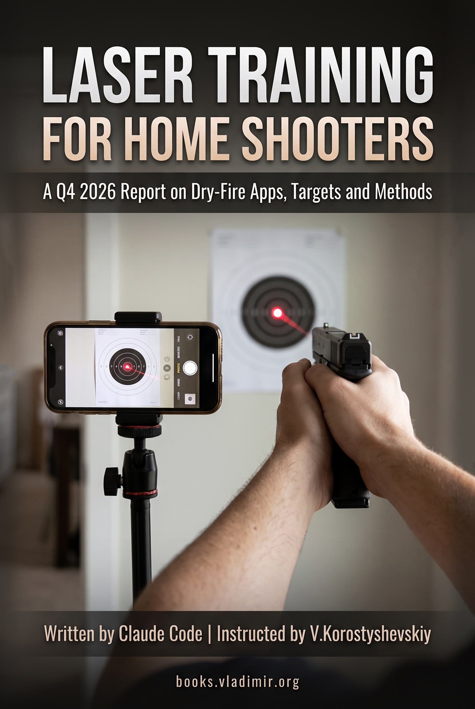

# Laser Training for Home Shooters

**A Q4 2026 Survey of Dry-Fire Apps, Targets, and Methods**

*Last updated: October 2026.*

A survey of laser dry-fire training as it stood in the fourth quarter of 2026. Sixteen chapters covering what dry fire is for and where the laser is still argued about, the safety rules that do not relax when the gun is empty, how a camera turns a dot on a wall into a score and a time, the three ways people build a range at home, why trainers register hits that never happened and miss ones that did, what the scoring and the timers actually measure, how these products charge, and what it takes to still be practising in six months.

## The editorial position

**No product in this report was bought, borrowed or tested.** Every statement about a product comes from what its maker publishes, checked against the vendor's own pages rather than taken from a review. Where owners contradict the vendor, the report says so and attributes both.

Two published training books supply the method the technology is measured against: Ben Stoeger's *Dryfire Reloaded* and Chris Cheng's *Shoot to Win*. Both were written before any of this software existed, which makes them a standard rather than a competing product claim. That matters, because the two instructors reach opposite verdicts on the same laser device — and that disagreement, rather than any feature list, is the frame you need to read a product page without being sold to.

**No prices appear anywhere.** Amounts in this category move faster than any report can, so products are described by how they charge instead: free, paid once, subscription, free with paid unlocks, or bundled with hardware. That shape outlives any particular figure, and it is the part that decides what you still own in three years.

## Read the book

- **EPUB** (for e-readers): [download](https://github.com/vkorost/laser-dry-fire-field-guide/releases/latest/download/Laser_Training_for_Home_Shooters.epub)
- **PDF**: [download](https://github.com/vkorost/laser-dry-fire-field-guide/releases/latest/download/Laser_Training_for_Home_Shooters.pdf)
- **Per-chapter Markdown**: see the [Table of Contents](#table-of-contents) below.

Both formats are attached to the [latest release](https://github.com/vkorost/laser-dry-fire-field-guide/releases/latest) and always point at the current revision.

## Why this exists

Dry fire with a laser is a category where the marketing and the instruction disagree, and the reader is left in the middle of it. Vendor pages describe systems that score every shot and fix your trigger pull. Serious instructors are split: one treats the laser as a useful supplement, another argues it teaches you to watch the wall instead of the sights. Both positions are reasoned, and neither is reachable from a product page.

Underneath that argument sits a second problem nobody sells you: these systems are a camera in a room, and a camera in a room has opinions about light. A great deal of what owners report as the app being broken is a reflection, a ceiling bulb, a red standby LED, or a cartridge sitting loose in the chamber. Knowing which failures are the product's and which are the room's is the difference between a setup you keep and one that ends up in a drawer.

This report assembles both: what the method says, what the hardware can and cannot do, and which of the failures you will meet are yours to fix.

## How it was made

Written with Claude, using the pipeline described in [weekend-diy-book](https://github.com/vkorost/weekend-diy-book): per-chapter assembly under explicit constraints, fact-tracing, deduplication, multi-pass review and editorial revision.

The research corpus:

| Source | Type | Coverage |
|--------|------|----------|
| Vendor documentation | Direct | Product pages, FAQs, manuals and support articles, checked October 2026 |
| Owner reports | Survey | App-store reviews and shooting forums, read for failure modes rather than for verdicts |
| Published training books | Direct | Stoeger, *Dryfire Reloaded*; Cheng, *Shoot to Win* |

Every chapter ends with its own numbered endnotes, so a chapter read on its own still shows where each claim came from. Superscript numbers in the body text refer to that list.

## The sixteen chapters

- **The argument and the machinery** (1–3): what is settled about dry fire, what is not settled about the laser, the safety rules that do not relax when the gun is empty, and the four steps by which a camera turns a dot into a score and a time.
- **Three ways to build a range** (4–7): a phone watching printed paper, camera software watching a target you supply, a screen or a projector — and the sensor and laserless trainers that sit outside all three.
- **When it goes wrong, and what it measures** (8–11): why your trainer misses and why it fires at nothing, what a score is worth, what timers and par times actually test, and how these products charge.
- **Keeping it up** (12–16): what keeps people practising, what a hit cannot tell you, a routine built on the technology, choosing a setup you will still be using, and what you will have to establish for yourself.

## Table of Contents

- [Preface](./book/chapters/00-preface.md)

**The argument and the machinery**
1. [Dry Fire Works, and the Dot Is Controversial](./book/chapters/01-the-dot-problem.md)
2. [The Rules Do Not Relax When the Gun Is Empty](./book/chapters/02-dry-means-dry.md)
3. [How a Camera Scores a Shot](./book/chapters/03-how-a-camera-scores-a-shot.md)

**Three ways to build a range**
4. [Three Ways to Build a Home Range](./book/chapters/04-three-ways.md)
5. [Phones on Tripods, Paper on the Wall](./book/chapters/05-phones-and-paper.md)
6. [Webcams, Projectors and Screens](./book/chapters/06-webcams-projectors-screens.md)
7. [Sensors, Reactive Targets and Laserless Trainers](./book/chapters/07-sensors-and-reactive-targets.md)

**When it goes wrong, and what it measures**
8. [Why Your Trainer Misses](./book/chapters/08-why-your-trainer-misses.md)
9. [Keeping Score](./book/chapters/09-keeping-score.md)
10. [Timers, Par Times and Splits](./book/chapters/10-timers-and-par-times.md)
11. [Free, Paid, Bundled](./book/chapters/11-free-paid-bundled.md)

**Keeping it up**
12. [What Keeps People Practicing](./book/chapters/12-what-keeps-people-practicing.md)
13. [Coaching, and What a Hit Cannot Tell You](./book/chapters/13-coaching.md)
14. [A Routine That Uses the Technology](./book/chapters/14-a-routine.md)
15. [Choosing a Setup You Will Keep Using](./book/chapters/15-friction-decides.md)
16. [What You Will Have to Establish Yourself](./book/chapters/16-establish-yourself.md)

## A note on safety

This report describes practice with an unloaded firearm. It is not a substitute for instruction, and nothing in it relaxes any rule of safe gun handling. Chapter 2 is the one chapter here with no trade-offs in it.

## What's not in scope

This is not instruction. It does not teach you to shoot, and it is not a substitute for a qualified instructor or for the published training books it draws on. It is not a buyer's guide in the usual sense: it carries no prices, no scores out of ten, and no single recommendation, because the right setup depends on a room and a routine the report cannot see. And it is not a review — nothing here was bought, borrowed or tested.

What it is: a map of a category, the physics that constrains every product in it, and the failure modes you will meet whichever one you pick.

## Disclaimer

This repository is independent and unofficial. It is not produced, endorsed, sponsored or reviewed by any company whose products it describes. Product and company names are trademarks of their respective owners, used here for descriptive reference only.

No product was bought, borrowed or tested. Every product statement is attributed in the endnotes either to the vendor's own published material as checked in October 2026, or to owner reports gathered from app-store reviews and shooting forums. Where the two disagree, the report says so rather than picking a winner. Several of these products are young, and young products change.

Nothing here is firearms instruction, legal advice, or a statement about what is lawful where you live.

## License

All content in this repository is licensed under **Creative Commons Attribution-NonCommercial-ShareAlike 4.0 International (CC BY-NC-SA 4.0)**. See [`LICENSE`](./LICENSE).

The prose may be shared and adapted for non-commercial purposes with attribution. Commercial reuse or redistribution of the written content (including republication as a book, course, or paid resource) is not permitted, and any derivative work must carry the same CC BY-NC-SA 4.0 license.

---

